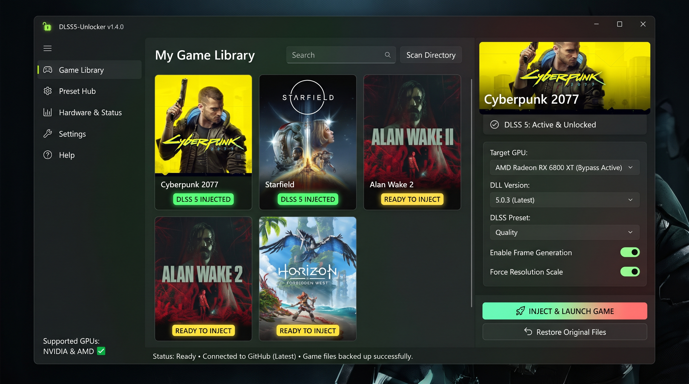

# DLSS5-Unlocker
Unlock and manage DLSS 5 on any NVIDIA or AMD graphics card. The ultimate one-click frame gen tool.
# 🚀 DLSS5-Unlocker

  

> **Unlock and manage DLSS 5 on any NVIDIA or AMD graphics card. The ultimate one-click frame gen tool.**

DLSS5-Unlocker is a universal manager and automated installer designed to bypass hardware restrictions and enable DLSS 5 (Deep Learning Super Sampling) and Frame Generation technologies on natively unsupported GPUs, including AMD Radeon and older NVIDIA GeForce series.

---

## ✨ Features

* **Universal Compatibility:** Works seamlessly across both NVIDIA (RTX 20/30 series, GTX) and AMD (RX 5000/6000/7000 series) architectures.
* **One-Click Installation:** Automatically detects game directories, backups original files, and replaces necessary `.dll` files without manual registry edits.
* **Built-in Version Manager:** Easily swap between different DLSS 5 versions to find the most stable release for a specific game.
* **Preset Configuration:** Tweak internal DLSS presets (Quality, Balanced, Performance) and force Frame Generation directly through the UI.
* **Auto-Updater:** Keeps your bypass and DLSS files up to date with the latest GitHub releases.

## 💻 Supported Hardware 

| GPU Manufacturer | Supported Series | Frame Generation |
| :--- | :--- | :--- |
| **NVIDIA** | RTX 40xx, 30xx, 20xx, GTX 16xx | ✅ Supported |
| **AMD** | RX 7000, 6000, 5000 series | ✅ Supported |
| **Intel** | Arc A-Series | ⚠️ Experimental |

*Note: Performance gains depend heavily on your base hardware and the specific game engine.*

## 📥 Installation

1. Go to the [Releases](../../releases) page and download the latest `DLSS5-Unlocker-Portable.zip`.
2. Run the `Main.exe` (Administrator privileges may be required to modify game files in protected folders).
3. Open the application.

## 🚀 How to Use

1. **Launch DLSS5-Unlocker.**
2. Click **"Add Game"** and select the main executable (`.exe`) of the game you want to mod.
3. Select your GPU architecture in the settings pane.
4. Click **"Inject DLSS 5"**.
5. Launch the game. Navigate to the in-game graphics settings and enable DLSS / Frame Generation. 

*(To revert changes, simply click **"Restore Original Files"** in the manager).*

## ⚠️ Important Disclaimer

**Use at your own risk in multiplayer games.** 
Replacing `.dll` files and injecting custom frame generation code can trigger anti-cheat software (such as Easy Anti-Cheat, BattlEye, Vanguard). It is strictly recommended to use DLSS5-Unlocker **only in single-player games** or offline modes. The developer is not responsible for any account bans or hardware instability.

## 🤝 Contributing

Contributions, issues, and feature requests are welcome! 
Feel free to check the [issues page](../../issues).

## 📄 License

This project is licensed under the [MIT License](LICENSE).
